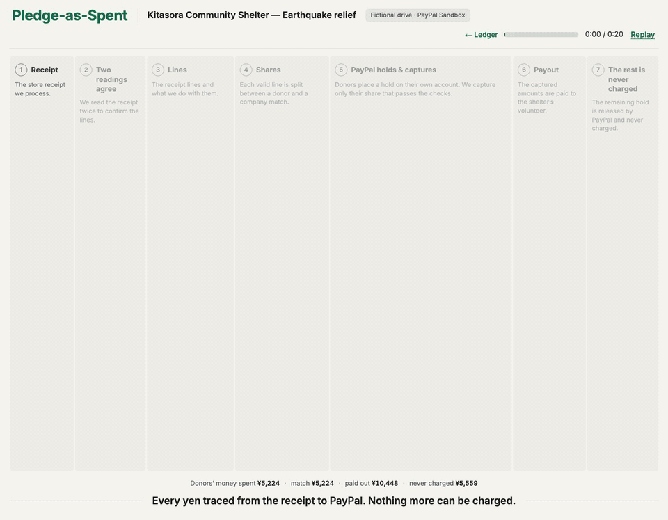
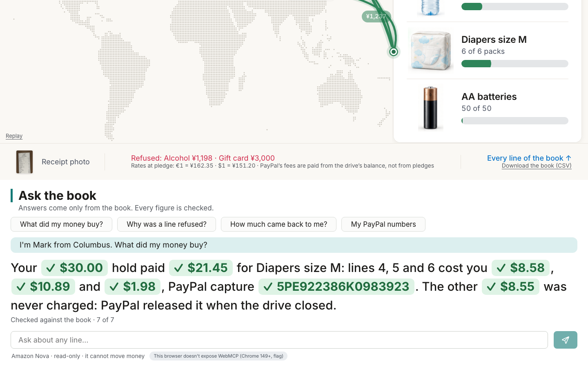
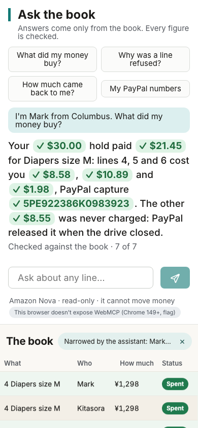

# Pledge-as-Spent



*The river of money on the live demo, from the receipt to "never charged" (sped up 2.5×).*

**Disaster relief where a donor's money moves only for receipt lines that pass the checks.** A pledge is a PayPal hold for one listed need. A volunteer photographs the receipt, AI reads each line in the store's own language, and every donor is charged only their share of the approved lines. Whatever is not spent is never charged: PayPal releases the rest of the hold.

Your €20 for water can only buy water.

In BBB Wise Giving Alliance's 2024 survey, an independent review of how a charity spends its money was the accountability check U.S. respondents valued most (75.9%). After the 2021 Texas freeze, Austin Mutual Aid drew more than 14,000 donors and reported a $2.6 million total, and Vice wrote: "Because AMA has so far failed to show their receipts, there is almost no way to check AMA's math." Here the receipt comes first and the charge second.

Live demo: **https://pledge-as-spent.vercel.app** · no login, no keys · a fictional drive in the PayPal sandbox, no real money moves.

Video: {YouTube URL}

## Judge it in 90 seconds

1. Open the demo and press **Open the demo drive**. Four holds are placed at PayPal.
2. On the Coordinator screen press **Use the sample receipt**: 9 lines approved, 2 refused, ¥10,448 to the volunteer.
3. Press **Capture now**: each share turns from waiting to spent once PayPal confirms it. Then press **Close drive** and confirm with **Yes, close the drive**.
4. Press **See where the money went**: the Ledger shows pledged, spent on needs and never charged, on a world map. Press a donor to see what they paid for.

| Claim | Proof | What you will see |
|---|---|---|
| Pledges in three currencies are held, not charged | PayPal authorizations `1RV76766T26737437` (EUR), `4TR76246YU647721D` (USD), `2CT29967LT177640T` (JPY) on [drive demo-810b24be50](https://pledge-as-spent.vercel.app/drive/demo-810b24be50?as=ledger) | €20.00, $30.00 and ¥3,000 held, one need each |
| One receipt is split across several donors' holds | captures `4VE88173NF234560B` (€4.58), `50398406KN1796230` ($21.45), `2CM40725YN406312S` (¥1,237) | each donor pays their own share, in their own currency |
| A company match is captured with them | capture `97T59974KS757452K` (¥5,224) | a second hold on the same lines, 1:1 up to a ¥500,000 cap |
| The volunteer is reimbursed through PayPal Payouts | batch `CB379GNVYPU8G` | ¥10,448, confirmed |
| Unspent money is never charged | the same drive, Ledger tab | €15.42, $8.55 and ¥1,763 never charged: PayPal voided every hold |
| Alcohol and a gift card are refused | [the same receipt](https://pledge-as-spent.vercel.app/drive/demo-810b24be50?as=coordinator) | ¥4,198 of ¥14,646 never reaches a donor |
| AI reads receipts in other languages | held-out [set 2](eval/results/meta-holdout2-h2-20261109T005251Z.md) and [set 1](eval/results/meta-holdout-fixed-20261109T004406Z.md), [more below](#how-ai-is-used) | Meta Muse Spark 1.3 on two sets of 20 receipts in 4 languages: line F1 100% and totals 20/20 on each, no line funded with a wrong need or quantity |
| The model never moves money | `src/core` | amounts are computed in code; the model only reads and labels lines |
| Try to cheat the receipt | [/cheat](https://pledge-as-spent.vercel.app/cheat) | five forged receipts (bought before the disaster, the paid receipt again, a store outside the zone, a total raised by hand, beer, cigarettes and a gift card among water) run through the same checks as every upload, on a copy of the demo drive: each line paid, refused or held with its reason, and what the forged lines would have charged donors. Each forgery's reading is the receipt set's own truth, written with the set, so no model reads anything here; nothing is written and PayPal is not called |
| Ask PayPal yourself | the button on the Ledger, beside the CSV (and on a donor's statement) | the server reads every hold, capture and payout of the drive back from PayPal's sandbox, GET only, and sets each answer next to the book: "N of N objects answered by PayPal". An answer is kept for a minute; fresh checks are limited per network |

The PayPal ids and amounts come from a control drive opened on the hosted demo on 2026-11-09: [`evidence/control-drive-20261109-810b24be50.json`](evidence/control-drive-20261109-810b24be50.json). PayPal's own records matched the ledger: 9 of 9 objects answered, 9 agree.

## The story

An earthquake, a shelter and three needs: water, size M diapers, AA batteries. This drive is fictional. Lena in Berlin pledges €20 for water, Mark in Columbus $30 for diapers, Yuki in Osaka ¥3,000 for batteries. A local company matches each yen 1:1, up to ¥500,000.

A volunteer buys supplies and photographs the Japanese receipt. Beer and a gift card are on it. AI reads every line, matches each to a need and applies the drive's rules. Nine lines pass, two are refused. The approved ¥10,448 is split: half from the company, half from the donors, each in their own currency. The volunteer is paid back the same day. When the drive closes, what nobody spent is never charged, because PayPal releases each hold, and each donor can see which receipt lines their money bought.

## How PayPal is used

| Step | PayPal API | Endpoint |
|---|---|---|
| Pledge | Orders v2, `intent: AUTHORIZE` | `POST /v2/checkout/orders` |
| Share of a verified line | partial capture, `final_capture: false` | `POST /v2/payments/authorizations/{id}/capture` |
| Capture after the 3-day honor period, wallet holds | reauthorize, from day 4; the 29-day limit stays | `POST /v2/payments/authorizations/{id}/reauthorize` |
| Volunteer reimbursement | Payouts | `POST /v1/payments/payouts` |
| Close, or a donor withdraws | void | `POST /v2/payments/authorizations/{id}/void` |
| "Paid" only when PayPal says so | Webhooks, signature verified | `PAYMENT.CAPTURE.*`, `PAYMENT.AUTHORIZATION.VOIDED`, `PAYMENT.PAYOUTS-ITEM.*` |

Shares are captured in batches: fewer fixed fees per capture. On the demo drive that saved €0.78, ¥490 and $0.98. A daily job looks up pending captures and payouts whose webhook did not arrive.

Speed: Meta's two readings and the classification take a median of about 25 seconds per receipt (24.5 s and 24.8 s on the two held-out sets: [set 1](eval/results/meta-holdout-fixed-20261109T004406Z.md), [set 2](eval/results/meta-holdout2-h2-20261109T005251Z.md)). After that, a receipt that passes every check goes to PayPal with no person in the loop; in two sandbox runs the payout showed SUCCESS at most 20.1 s and 22.4 s after the Payouts call ([`evidence/e2e-20261023T154039Z.json`](evidence/e2e-20261023T154039Z.json), [`evidence/e2e-20261023T154908Z.json`](evidence/e2e-20261023T154908Z.json)). `scripts/paypal-proof.mjs` prints PayPal's own `time_created` and `time_completed` for a drive's payout.

The server uses the official [`@paypal/paypal-server-sdk`](https://www.npmjs.com/package/@paypal/paypal-server-sdk), generated by APIMatic, and direct REST where the SDK has no call.

## How AI is used

Receipts are read only by Meta's models, twice and independently. Meta Muse Spark 1.3 reads the whole photo once. Code then finds every printed row by its pixels, cuts the rows out and lays them on a numbered sheet, and Muse Spark reads that sheet a second time: the number next to each row is the row's exact place on the photo, so no model coordinates are used. One Muse Spark text call matches the lines of both readings to the drive's needs and rules. Then code compares: a line is funded only when both readings agree on its amount (to the cent), on the quantity code derives from the printed row and pack size, and on the need. When they disagree, arithmetic decides first (the reading whose quantity times unit price makes the printed amount), then a third Muse Spark reading of that line's rows, enlarged, which counts only if it agrees with one of the two and adds up. Anything still unsettled waits for the coordinator. A refusal for alcohol, tobacco or a gift card stands if either reading sees it. Deterministic code decides the rest: duplicates, purchases before the disaster, stores outside the zone, totals that do not add up, and every amount of money.

Only the purchase lines' rows are ever shown: the published copy of a receipt keeps those rows and turns everything else (name, card, address, member number) into plain paper. On held-out set 1, closing left 0 of 42 personal data items visible and closed no printed pixel of the 103 purchase lines, both with each receipt's rows taken from its page and with the rows the reader finds by pixels, as for a live receipt ([`docs/closing-benchmark.md`](docs/closing-benchmark.md)).

The prompts were first tuned on three sets of synthetic receipts, so the numbers to quote come from sets they never saw. Held-out set 1: 20 receipts in Japanese, Turkish, Spanish and English with fresh seeds and their own shelf of products. Held-out set 2: 20 more, with another shelf of products and other stores, made and committed before any change that set 1 suggested.

| Held-out receipts | [Set 2](eval/results/meta-holdout2-h2-20261109T005251Z.md) (never seen) | [Set 1](eval/results/meta-holdout-fixed-20261109T004406Z.md) (after the changes) |
|---|---|---|
| Line F1 | 100% | 100% |
| Receipt total exact | 20/20 | 20/20 |
| Date exact | 20/20 | 20/20 |
| Line class (verdict + need) | 99/99, 100% | 95/98, 96.9% |
| Need quantity exact | 58/58, 100% | 57/60, 95.0% |
| Forbidden lines refused with the right code | 10/10 | 10/10 |
| Lines funded with a wrong need or quantity | 0 | 0 |
| Lines sent to the coordinator | 0 of 99 | 1 of 98 |

Set 1's changes came after looking at its first run ([`eval/results/meta-holdout-20261109T001827Z.md`](eval/results/meta-holdout-20261109T001827Z.md)) and its repeat: a tax base is never the subtotal, the arithmetic and third reading above, and one rule found on the repeat. There both readings agreed on a wrong quantity because code did not know a pack word ("6 ADET"), so a quantity code reads from the row that the model counts differently, with no pack size in the name, now goes to the coordinator instead of passing. Set 1 is therefore not held-out for the changed code; set 2 is. On the 13 adversarial receipts (re-shot duplicates, purchases before the disaster, stores outside the zone, forbidden goods; [`eval/results/meta-adversarial-20261109T002345Z.md`](eval/results/meta-adversarial-20261109T002345Z.md)) every check scored 13 of 13 or all of its cases, except two deliberately out-of-focus photos: the first reading gave no answer for them, which the code now turns into an "unreadable" flag (not measured live since). All receipts are synthetic photos of fictional stores; real crumpled receipts will read worse. A receipt costs about $0.03 at Meta's prices for the two readings and the classification ($0.5850 and $0.5931 for the 20 receipts of each set). Details, every run and its spend: [`docs/reading-benchmark.md`](docs/reading-benchmark.md), `npm run eval -- --reader meta`.

Live reading has its own budget ceiling of $5 in code (`META_READ_CAP_USD` can lower it, not raise it), apart from the assistant's, with a ledger of every model call. A photo recognized as the demo's sample gets its saved reading (Meta's real answer from the benchmark run, not a hand-written one), on demo drives only, and the screen says so. The benchmark receipts ship with recorded readings, so they use no model call. Any other photo is read live.

## Ask the book

The Ledger tab has a chat over the book. A donor asks in their own words, for example "I'm Mark from Columbus. What did my money buy?", and gets an answer in which every figure is a green chip. Pressing a chip narrows the book to the lines behind it.



**How the agent works.** It is built on AG Studio's Agent Framework (3.0.0).

- Our agent, `ledger`, is Studio's primary agent: a `directLlmRunner` with six read-only tools over the drive the page already holds (`ledger_find_donor`, `ledger_donor_money`, `ledger_line`, `ledger_refusals`, `ledger_paypal_ids`, `ledger_totals`). The tools hand the model amounts already formatted with their currency, and they add up the totals per donor and per need, so the model never has to add anything.
- For a figure across all donors ("How much went to water across all donors?") it hands the task to Studio's built-in `data` agent with `delegate_to`. That agent runs `execute_query` on the book in Studio's own data engine. It keeps only `execute_query` and `view_schema`, so it cannot change the report.
- Studio's agent loop runs in the browser. Each model turn goes to `/api/agent/turn`, which calls Meta Muse Spark 1.3 without streaming, within limits: 4 questions an hour and 10 a day per network, 20 a day in all, 10 model calls and about 64,000 input tokens per question, and Meta's ceilings: $5 in code at most and $0.50 over any 24 hours. Muse Spark is the only model: a turn it fails is tried once more on Muse Spark, and then the chat says "The assistant is busy, please try again in a minute." (in English, German or Japanese). The live agent runs only when the server is given `AGENT_META_ALLOWED=yes`, a ceiling in `META_AGENT_CAP_USD` and a key.
- The book is shown in Studio's view mode, which has no chat panel, so the chat is a custom widget in the book's own layout, on Studio's chat session. Studio rebuilds the report when the layout or the language changes. The conversation lives outside it, and an answer cut short by a rebuild says so and offers to ask again.
- The four quick questions are answered by the book's own code with the same tools and no model, so they keep working when the live AI has used its questions.
- "Ask about this line", in a row's proof band, sends that line to the chat.

**Numbers only from the book.** A wrapper around the model checks each final answer before anyone sees it. Every figure it finds in the answer must match a figure a tool returned for this question. Figures that the data agent wrote in its own summary do not count, only its query results. If something does not match, the model is asked once more; if it still does not match, the reader sees "I can't confirm that figure from the book." Text that was not checked is never shown: the model's answer is shown only after the check, and when our agent hands work to the data agent the chat shows a fixed sentence for what the data agent ran, not the model's instructions.

The check finds these forms ([`src/agent/money-parse.ts`](src/agent/money-parse.ts)):

- an amount with a currency symbol, at any size: before the number `$`, `US$`, `C$`, `CA$`, `A$`, `AU$`, `€`, `£`, `¥`; after it `$`, `€`, `¥`, `円`; in English, German and Japanese number forms ("$1,234.56", "1.234,56 €", "10 448 円"), full-width digits included ("￥１，２３７");
- an amount with an ISO code in capitals before or after it: USD, EUR, JPY, GBP, CAD, AUD;
- a bare number with two decimals, or above 100 (years 1900–2099, dates, times and quantities with a unit such as "2 L" or "3 枚" are left alone);
- a PayPal id in capitals: 17 characters, or 13 to 20 with both a digit and a letter;
- a share: "23 %", "23 Prozent", "23 パーセント", and words that claim all or half of an amount ("all of it", "in full", "ganz", "vollständig", "全額", "全部", "half of it", "die Hälfte", "半分"), checked against what it is a share of.

What it does not catch:

- a currency written as a word: "20 euros", "20 Euro" and "21 dollars" are not claims at all, and "1,237 yen" is checked only as the bare number 1,237;
- Japanese 万 and 千: "1万円", "2千円" and "2千" are not claims at all;
- an ISO code in small letters ("usd 21.45" is checked only as the bare number 21.45) and a PayPal id in small letters (not a claim);
- a bare number with one decimal ("it was 21.5"), a code in mixed case ("Eur 99"), a currency the check does not know ("CHF 99"), and other words for a share ("すべて", "completely", "a third"): none of these is a claim;
- a bare number with decimals or above 100 matches a figure of the same value in any currency, so "21.45" passes when the book has $21.45 even if the sentence means euros;
- a figure that is in the book but answers another question (in one measured run the data agent read the wrong row and the answer gave ¥3,000, the gift card, for water), a wrong statement without a figure, and bare counts of 100 or less.

Each line of both lists is pinned by a test on made-up text (`src/agent/guard.test.ts`, "README: the forms the check finds and the ones it misses").

**Models and the measure.** Seven donor questions on the closed demo drive, in English, German and Japanese, with the right figures computed from the book by code. An answer counts as right when it states every required figure, the check did not have to step in, it states no figure outside what the relevant tools returned, and it has no false percentage.

| Model | Right of 7 | Model calls per question | Cost per question |
|---|---|---|---|
| Meta Muse Spark 1.3 (variant D, the one the agent runs on) | 7 with correct figures, 6 by the strict score (final code) | 2.29 | $0.016 |

Ask the book, live on Meta Muse Spark: 7 of 7 test questions answered with correct figures; 6 of 7 by the strict score, one answer also named the other needs' totals ([`eval/agent/results-D5.json`](eval/agent/results-D5.json), the run on the final code). Earlier live runs on older code are kept with their scores in [`eval/agent/`](eval/agent): 7 of 7 twice; 6 of 7 once, when the check misread "Linie 2 €1.45" as 2 euros (fixed); one stopped at the size limit of a single question (since raised). All answers are scored by the same rules, including the false-percentage rule (a pledge called spent "zu 100%" when 23% was is wrong). The cost is Meta's price for each turn's tokens: $1.25 / $4.25 per million input / output tokens. The runs of the variants that were tried and dropped are kept as they were recorded, with their scores, in [`eval/baseline-legacy/agent/`](eval/baseline-legacy/agent).

The chat's small print names the model: "Meta Muse Spark". Meta spend is capped at $5 in code (`META_AGENT_CAP_USD` can lower that, not raise it; $0.50 over any 24 hours unless `META_AGENT_DAILY_CAP_USD` says less); past either ceiling the chat says the demo's budget for live questions is used up. A turn Muse Spark fails and then answers on its second try counts as one of the 10 model calls of the question, so up to 20 requests can leave the server for one question. Recorded runs and the scorer: [`eval/agent/`](eval/agent), `npx tsx scripts/agent-measure.ts --mode D`.

**WebMCP.** The book's six tools and Studio's four read-only tools are also offered to the browser's own AI through WebMCP (`document.modelContext`), each marked read-only. WebMCP is experimental: it needs Chrome 149 or later with the WebMCP testing flag (`chrome://flags/#enable-webmcp-testing`, or `--enable-features=WebMCPTesting`). With it, one line under the chat says how many tools the browser's AI can call; without it, nothing is shown.

**Statement as Excel and PDF.** A donor's statement page downloads as an Excel file, written by this repository's own code without a spreadsheet library, and prints as an A4 page for "Save as PDF".



## How it differs

Receipt reading for donors already exists, for example Kindtrail in this hackathon. The difference is where the money sits and when it is taken:

- The money stays on the donor's own PayPal hold until a verified purchase. Nothing is collected first and explained later.
- One receipt line is shared across donors and a company match, each charged in their own currency.
- The Ledger splits every pledge into spent, waiting for capture, still held and never charged, and the parts add up to the pledge. "Returned" is used only for money PayPal gave back after a capture, a refund.
- A donor can move what is left of their hold to another open need with one press on their statement, before the drive closes. PayPal is not asked for anything: the same authorization, for the same amount and the same expiry, now backs the new need, and the book records the donor's consent and the time. On a sandbox drive the authorization read back the same before and after, with no PayPal call between ([`evidence/florida-sandbox-20261109T001355Z.json`](evidence/florida-sandbox-20261109T001355Z.json)). Switched on in the hosted demo (`REBIND_ENABLED`).
- **Keep the rest for this drive** (`REBIND_ENABLED`): at the pledge a donor chooses what happens to the rest once their need is covered: it is never charged, or it keeps buying for this drive, moving by itself to the open need furthest from covered. The same PayPal hold; moving it calls nothing at PayPal.
- **Renew a hold** (`RENEW_ENABLED`): PayPal ends a hold 29 days after the donor approves it, and a reauthorize keeps that day. The statement shows the end date and a Renew button while the hold is alive, brighter in its last 3 days (no e-mails). Renewing is a new PayPal order for what the hold has not paid for, approved again by the donor; the old hold pays what it already bought, then PayPal releases it. Across renewals a donor is never charged more than they first pledged. Run live in the sandbox: [`evidence/renew-sandbox-20261110T033537Z.json`](evidence/renew-sandbox-20261110T033537Z.json).
- **Volunteers by invitation** (`VOLUNTEER_INVITES`): the coordinator invites volunteers by name and PayPal address; each gets a personal upload link (only its hash is stored). Only an invited volunteer's receipts are taken, a person checks each new volunteer's first receipt on a real drive (the demo drive's own volunteer goes through at once), a limit caps what one volunteer is paid, and the payout goes only to that volunteer's PayPal address, which screens show masked.
- **Donor rules per line** (`DONOR_RULES`): a donor may limit the lines their hold pays: only some needs, and at most a price per unit in their own currency (its share of tax included). A line is split only between holds whose rules allow it; a line that no hold of its need may pay is refused and the need stays open for a cheaper purchase. The statement lists the lines a rule kept the hold out of.

## Platform findings

- One USD sandbox merchant held authorizations in EUR, USD and JPY with no setup, and several partial captures work on each.
- A hold has a 29-day limit. `reauthorize` from day 4 returns a new authorization id but keeps the same `expiration_time`.
- After a reauthorize, capture works with both ids, but void works only with the original id; voiding the new one returns `CANNOT_BE_VOIDED`.
- A reauthorize on a partly captured hold works. A second one right after the first returns `REAUTHORIZATION_TOO_SOON`.
- Every capture is charged a percentage plus a fixed fee in its own currency, so batching shares saves real money.
- Repeating a capture with the same `PayPal-Request-Id` returns the original capture and makes no second one.
- JPY amounts are whole numbers in both directions.

Full list with evidence: [`docs/platform-findings.md`](docs/platform-findings.md).

## Red team

60 attacks on the money path, each with its test: [`docs/red-team.md`](docs/red-team.md). All 60 hold; five did not when first tried and were fixed. 1563 unit and integration tests, 175 browser tests.

Mutation testing of the money rules of the four switched-on features (and of the pledge amount reading): 82 mutants, 80 caught by the tests; the 2 left change nothing the book or a screen can show. Property test: 1,000 random drives per run, in six currencies.

## Run it

The hosted demo needs nothing. To add a pledge there, use your own PayPal sandbox personal account.

Local:

```bash
npm ci
npm run dev
```

The app opens at http://localhost:3000 with a local PGlite database. Opening a drive needs your own PayPal sandbox app: set `PAYPAL_CLIENT_ID` and `PAYPAL_CLIENT_SECRET`, and `NEXT_PUBLIC_PAYPAL_CLIENT_ID` for the pledge form. Live reading is optional: `READING_PIPELINE=meta`, `READ_META_ALLOWED=yes`, a ceiling in `META_READ_CAP_USD` (at most $5 in code) and a Meta Model API key in `META_MODEL_API_KEY`; without them, only the sample and benchmark receipts are read. The server settings are listed at the top of [`src/server/runtime.ts`](src/server/runtime.ts).

To check a drive against PayPal's own records, read-only: `PAYPAL_CLIENT_ID=... PAYPAL_CLIENT_SECRET=... node scripts/paypal-proof.mjs <drive id>`. It takes the drive's PayPal ids from its public API, asks PayPal's sandbox for each hold, capture and payout with GET only (plus PayPal's token exchange), prints "N of N objects answered by PayPal" and writes the answers to `evidence/`. The ids are visible only to the sandbox app that made them, so use the keys of that app.

A Telegram bot takes receipts through the same reading path, with Approve and Reject buttons for the coordinator: [`src/server/telegram.ts`](src/server/telegram.ts). It is not part of the hosted demo. It needs your own bot token next to the PayPal settings above: `TELEGRAM_BOT_TOKEN=... npm run bot:poll`.

## Sponsor tools

**AG Grid: AG Studio.** The Ledger tab is one AG Studio report. Its totals are built-in value widgets, every line of the book is a built-in grid widget, and the map and the shelter card are custom widgets. Pressing a donor sets Studio's own cross-filter on the book. The theme and layout are tuned to the product, with a separate one-column layout for phones. The chat over the book is a custom agent in Studio's Agent Framework that hands work to Studio's built-in data agent, shown in a custom widget in the report's layout ([Ask the book](#ask-the-book)).

AG Studio is a commercial product, used here under the free trial licence offered to this hackathon's entrants: the `ag-studio`, `ag-studio-react`, `ag-grid-enterprise` and `ag-charts-enterprise` npm packages are not covered by this repository's MIT licence and none of their code is in it. Land dots: Natural Earth, public domain.

## Limits

- A PayPal hold lives 29 days at most. Renewing it needs the donor in PayPal's window again; on the demo drive PayPal's sandbox test card approves it, as it approves the demo's first holds. At most six renewals per pledge.
- On a real drive only the coordinator invites volunteers and decides on their receipts (`COORDINATOR_SECRET` bearer). The hosted demo sets no coordinator secret, so on a real drive there these volunteer controls are read-only (the server answers 403); the demo's own drives work in full. The demo drive is open, as the rest of the demo, and pays sandbox addresses only. Volunteers are invited before a drive's first receipt.
- Donor rules are fixed at the pledge; a renewal keeps them.
- The volunteer still pays first and is reimbursed afterwards.
- The payout goes out before donors' shares are captured, from the drive's PayPal balance, and that balance also pays PayPal's fees. A real shelter needs money in its PayPal account up front.
- Fictional drives and synthetic receipts, no real donations. The Florida drive ("Open the Florida drive" on the hosted demo; a deployment offers it with `NEXT_PUBLIC_FLORIDA_DEMO=on`) is a fictional shelter in Hallandale Beach after a fictional storm; it also takes a real Florida grocery receipt (2019, "Try a real 2019 receipt"), published only as its closed copy, which the checks hold back as bought before the storm. Its line "ICE CUBES SPEARMNT" is spearmint chewing gum, and Meta reads it correctly: the line is refused as gum, not counted as the drive's bagged ice.
- Receipt reading was measured on synthetic receipts only (two held-out sets of 20). A line both readings misread the same way would pass; none did in these runs. A refusal never overcharges a donor, but it can underpay a volunteer.
- Receipt photos are published closed: only purchase lines are visible, everything else is a plain background; a photo that cannot be closed is not published. A purchase line's own text is shown as printed, so a name printed inside an item line would be shown too.
- Muse Spark sees the whole original photo, card and name included. A photo whose rows cannot be found (a WebP photo, which has no pure-JS decoder here) gets no second reading, so its lines wait for the coordinator.
- Rates are a fixed demo snapshot, for the dollar drive too (EUR and JPY to USD are the yen rates divided out).
- A hold moves to another need once, only while the drive is open, and not in its last 3 days. Lines it already paid for stay with the first need. The company match follows donor money, so a need left without donors gets no match either.

## What's next

- Store check against each country's official registry: in Japan by the qualified-invoice number "T" + 13 digits printed on the receipt, in Florida by the store's name and address in the state's business registry (Sunbiz). Not built yet: the ID for the Japanese tax agency's Web-API is issued only after a few days, the synthetic receipts here carry no real numbers, and in Florida the check is weaker, because the receipt prints no registry number.
- Money for the volunteer before the purchase. Today the volunteer pays at the till and is reimbursed afterwards.
- Real receipts. Reading was measured on synthetic receipts only; the one real receipt in the demo (Florida, 2019) tests the before-the-disaster check, not reading accuracy, and real crumpled receipts will read worse.

## How this was built

Built by Nadezhda Korchagina with Claude Code as the development tool, after October 1, 2026. Product AI: Meta Muse Spark 1.3 reads every receipt (twice, with a third look at a disputed line); the Ledger's assistant runs on Meta Muse Spark 1.3 alone.

## License

[MIT](LICENSE)
